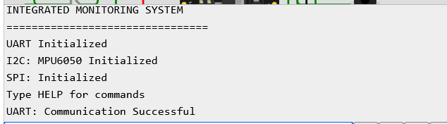
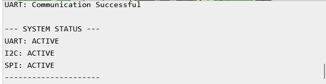
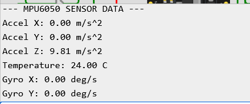

# Integrated UART + SPI + I2C Monitoring System

## Overview
An ESP32-based embedded monitoring system integrating UART communication, I2C sensor interfacing, and SPI-driven output control.

## Hardware Components
- ESP32 DevKit V1
- MPU6050 Accelerometer and Gyroscope
- 74HC595 Shift Register
- LED
- 220Ω Resistor
- Breadboard and jumper wires

## Communication Interfaces

### UART
- Serial command interface at 115200 baud
- PING, STATUS, SENSOR, LED ON, LED OFF and HELP commands

### I2C
- MPU6050 interfacing at address 0x68
- Reads accelerometer, gyroscope and temperature data

### SPI
- ESP32 SPI MOSI and SCLK control a 74HC595 shift register
- GPIO latch control updates the LED output

## Software and Tools
- Embedded C/C++
- Arduino IDE
- ESP32
- Wokwi Simulator

## Testing and Results
The integrated system was successfully tested in Wokwi simulation.

### 1. UART Communication Test
- Command: `PING`
- Result: UART communication successful.

### 2. System Status Test
- Command: `STATUS`
- Result: UART, I2C and SPI initialized successfully.

### 3. MPU6050 Sensor Test
- Command: `SENSOR`
- Result: Accelerometer, gyroscope and temperature readings received successfully.

### 4. SPI LED Control Test
- Commands: `LED ON` and `LED OFF`
- Result: SPI-driven LED control verified using the 74HC595 shift register.

## Project Status
Successfully implemented and tested in Wokwi simulation.

Physical hardware validation of the integrated system is pending.
